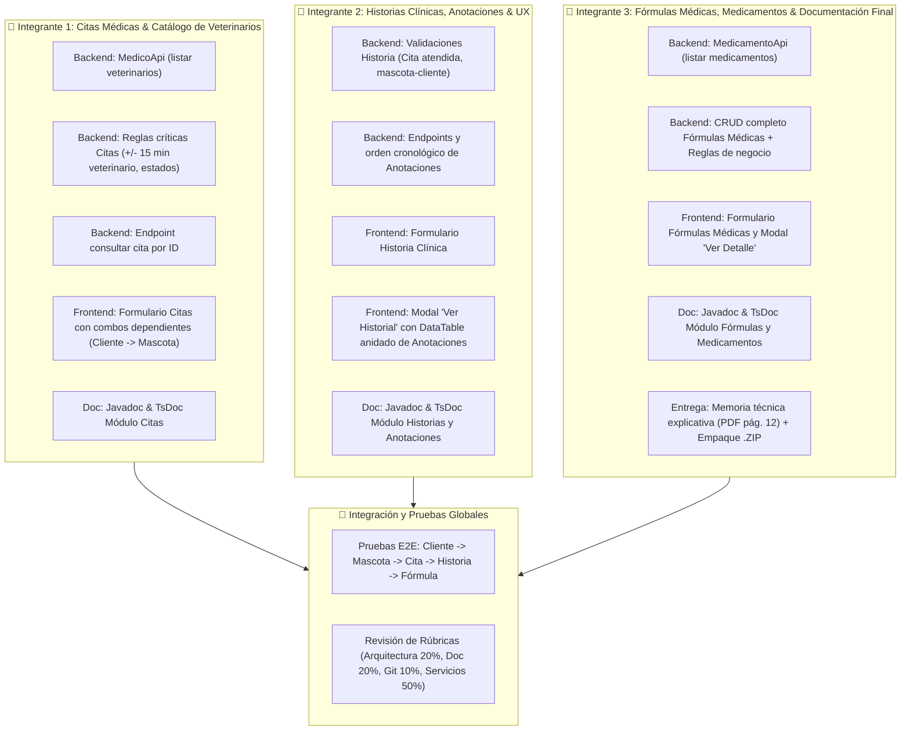

# Plan de Trabajo - Segundo Parcial de Programación Web
**Proyecto:** Sistema de Gestión para Clínica Veterinaria (Backend Spring Boot + Frontend Angular)  
**Modalidad:** Trabajo en Equipo (3 Personas)  
**Duración Sugerida:** 4 a 6 horas  
**Documento Base:** *SEGUNDO PARCIAL DE PROGRAMACIÓN WEB - ING. GIOVANNI MORA JAIMES*  

---

## 1. Diagnóstico del Estado Actual vs. Requerimientos del Parcial

| Módulo / Requisito | Estado en Backend (`backend2026-83682`) | Estado en Frontend (`frontend26-83682`) | Brecha a Resolver |
| :--- | :--- | :--- | :--- |
| **1. Citas Médicas** | ⚠️ Existen `listar-por-fecha`, `guardar` y `actualizar`. | ⚠️ Solo filtro por fechas y listado básico. | Faltan reglas críticas: solapamiento de veterinario (+/- 15 min), solapamiento de mascota, fechas no pasadas, validación de estados (`cancelada` no modificable, `atendida` protegida), endpoint `consultar/{id}` y formulario reactivo con combos dependientes. |
| **2. Historias Clínicas y Anotaciones** | ⚠️ CRUD básico implementado. | ⚠️ Solo tablas básicas de lectura. | Falta formulario de registro con validación cliente-mascota-cita y **Modal Ver Historial** con DataTable anidado de anotaciones históricas ordenadas de reciente a antigua. |
| **3. Fórmulas Médicas** | ⚠️ Solo implementado `listar` (`/formula-medica/listar`). | ⚠️ Solo tabla básica de lectura sin acciones. | Falta CRUD completo (`guardar`, `actualizar`, `consultar`), DTO `FormulaMedicaRq`, formulario reactivo, validación de consulta previa, dosis/duración y modal de detalle completo diferenciado del listado. |
| **4. Catálogos Base (Médicos, Medicamentos)** | ⚠️ No existen `MedicoApi` ni `MedicamentoApi`. | ⚠️ Componentes `medico` y `medicamento` vacíos/planos. | Se requieren endpoints `GET /medico/listar-todos` y `GET /medicamento/listar-todos` para alimentar los `<select>` de los formularios. |
| **5. Documentación y Entregables** | ⚠️ Incompleta (faltan Javadocs en métodos clave). | ⚠️ Muy poca documentación en componentes y servicios. | Vale el **20%** de la nota. Debe documentarse cada método, clase y atributo (Javadoc y TsDoc) y redactarse la memoria técnica (PDF pág. 12). |

---

## 2. Arquitectura de Roles y División de Trabajo (3 Desarrolladores)

Para garantizar alta cohesión, independencia de desarrollo y cero conflictos en Git, se asigna **un módulo funcional completo (Backend + Frontend) y una responsabilidad transversal a cada integrante**:



---

## 3. Plan Detallado por Integrante

### 👤 Integrante 1: Módulo de Citas Médicas & Catálogo de Veterinarios
* **Objetivo:** Garantizar el flujo de agendamiento de citas respetando todas las reglas de negocio de tiempo y estado.

#### Tareas Backend (`backend2026-83682`):
1. **Catálogo de Veterinarios:**
   - Crear `MedicoApi`, `MedicoApiController`, `MedicoService` y `MedicoServiceImpl`.
   - Endpoint: `GET /medico/listar-todos` para retornar los médicos activos.
2. **Reglas de Negocio en `CitaServiceImpl` (PDF pág. 5):**
   - **Regla 2:** Validar que la mascota seleccionada pertenezca al cliente (`mascota.getCliente().getClienteId().equals(clienteId)`).
   - **Regla 4:** Validar solapamiento de veterinario en un rango de **15 minutos antes y 15 minutos después** (`fechaHora.minusMinutes(15)` a `fechaHora.plusMinutes(15)`).
   - **Regla 5:** Validar que la mascota no tenga dos citas simultáneas en el mismo horario.
   - **Regla 6:** No permitir citas en fechas anteriores a la fecha actual (`fechaHora.isBefore(LocalDateTime.now())`).
   - **Reglas 8 y 9:** Restricciones de estado:
     - Una cita con estado `cancelada` no puede modificarse como si continuara activa.
     - Una cita con estado `atendida` no permite modificar arbitrariamente su información histórica.
   - Endpoint de consulta: `GET /cita/consultar?citaId={id}`.

#### Tareas Frontend (`frontend26-83682`):
1. **Servicio Angular:** Crear `medico.service.ts` y actualizar `cita.service.ts`.
2. **Formulario Reactivo de Citas (`cita.component`):**
   - Modal con Reactive Form (`FormGroup`).
   - **Combos dependientes:** Al seleccionar un `Cliente`, disparar petición a `MascotaService.buscarPorCliente(clienteId)` para mostrar únicamente sus mascotas.
   - Campos: Cliente, Mascota, Veterinario, Fecha, Hora, Motivo, Estado (`Pendiente`, `Confirmada`, `Atendida`, `Cancelada`, `Programada`).
   - Acciones de tabla: Botón "Editar" (con bloqueo según estado) y acción para cancelar cita.

---

### 👤 Integrante 2: Módulo de Historias Clínicas y Anotaciones
* **Objetivo:** Implementar el seguimiento clínico del paciente con visualización anidada de anotaciones cronológicas.

#### Tareas Backend (`backend2026-83682`):
1. **Reglas de Negocio en `HistoriaMedicaServiceImpl`:**
   - Validar que la mascota pertenezca al cliente.
   - Validar que la cita asociada esté en estado `atendida` (PDF pág. 5 regla 9).
   - Endpoint de consulta: `GET /historia-medica/consultar?historiaId={id}`.
2. **Gestión de Anotaciones en `AnotacionHistoriaServiceImpl`:**
   - Garantizar orden descendente por fecha (de la más reciente a la más antigua).
   - Validar existencia de historia y veterinario en `guardarAnotacionHistoria`.
   - Endpoint `GET /anotacion-historia/consultar?anotacionId={id}`.

#### Tareas Frontend (`frontend26-83682`):
1. **Formulario Reactivo de Historia Clínica (`historia-medica.component`):**
   - Modal para crear nueva historia asociada a: Cliente -> Mascota -> Cita atendida -> Veterinario -> Diagnóstico y Observaciones iniciales.
2. **Modal "Ver Historial" (PDF pág. 7):**
   - Botón "Ver" en cada registro del listado de historias que abra un modal detallado.
   - Presentar un **DataTable anidado** con el histórico de anotaciones de esa mascota.
   - Permitir filtrar anotaciones, ordenar por fecha y paginar.
3. **Formulario de Anotaciones (`anotacion-historia.component`):**
   - Modal para agregar una nueva anotación clínica (Fecha/hora, Veterinario, Descripción, Observación, Diagnóstico/Evolución) a una historia clínica existente.

---

### 👤 Integrante 3: Módulo de Fórmulas Médicas, Medicamentos & Documentación Final
* **Objetivo:** Desarrollar el módulo de prescripción médica, inventario y consolidar los entregables para calificación.

#### Tareas Backend (`backend2026-83682`):
1. **Catálogo de Medicamentos:**
   - Crear `MedicamentoApi`, `MedicamentoApiController`, `MedicamentoService` y `MedicamentoServiceImpl`.
   - Endpoint: `GET /medicamento/listar-todos`.
2. **CRUD y Reglas de Negocio de Fórmulas (`FormulaMedicaServiceImpl` - PDF pág. 2-3):**
   - Crear DTO `FormulaMedicaRq` (citaId, medicamentoId, dosis, frecuencia, duracion, indicaciones).
   - Endpoints:
     - `POST /formula-medica/guardar`
     - `POST /formula-medica/actualizar`
     - `GET /formula-medica/consultar?formulaId={id}`
   - **Reglas críticas:**
     - La cita debe existir y corresponder a la mascota indicada (no asociar a consulta de otra mascota).
     - La fecha de emisión no puede ser anterior a la fecha de la consulta.
     - Dosis y duración deben ser valores válidos.
     - Prevenir eliminación física si ya tiene historial clínico (inactivación o bloqueo).

#### Tareas Frontend (`frontend26-83682`):
1. **Formulario Reactivo de Fórmulas (`formula-medica.component`):**
   - Formulario reactivo para registrar/editar fórmula asociada a: Mascota -> Cita -> Veterinario -> Medicamento -> Dosis -> Frecuencia -> Duración -> Indicaciones.
2. **Visualización y Detalle Diferenciado (PDF pág. 3):**
   - Listado en DataTable resumido (columnas clave).
   - Botón "Ver" que abra un modal con el detalle completo de la prescripción.

#### Tareas de Entrega y Calidad (PDF pág. 12-14):
1. **Memoria Técnica (Documento Breve):**
   - Modelo de datos utilizado (diagrama y descripción de entidades).
   - Listado exhaustivo de endpoints implementados (métodos HTTP, URLs, parámetros).
   - Explicación de las principales reglas de negocio implementadas y su justificación.
   - Decisiones técnicas relevantes (manejo de excepciones, Hibernate dialect, OpenJDK 26).
2. **Empaquetado:** Compilación de ambos proyectos (`mvn package` y `ng build`), verificación de rama Git (`codigo_nombre`) y generación del archivo `.zip` final.

---

## 4. Cronograma de Ejecución Conjunta (5 Fases)

```
[Hora 0:00 - 1:00] ─── FASE 1: Catálogos Base (Médicos y Medicamentos) & Setup Angular
[Hora 1:00 - 2:30] ─── FASE 2: Módulo Citas (Reglas 15 min, combos dependientes)
[Hora 2:30 - 4:00] ─── FASE 3: Historias Clínicas (Modal Ver Historial + Anotaciones)
[Hora 4:00 - 5:00] ─── FASE 4: Fórmulas Médicas (CRUD + Modal Ver Detalle)
[Hora 5:00 - 6:00] ─── FASE 5: Javadoc (20%), TsDoc (20%), Pruebas E2E y Empaque ZIP
```

---

## 5. Rúbrica de Calificación y Criterios de Aceptación (100%)

| # | Criterio | Peso | Criterio de Aceptación | Responsable Principal |
| :---: | :--- | :---: | :--- | :---: |
| **1** | **Arquitectura, diseño y calidad del código** | **20%** | Respetar capas del backend (`api`, `controller`, `service`, `serviceimpl`, `repository`, `models`, `entity`) y frontend (`components`, `services`, `models`). Código limpio y sin redundancias. | Todos |
| **2** | **Documentación y buenas prácticas** | **20%** | Javadoc completo en el 100% de clases y métodos Java. TsDoc en Angular. Capacidad de sustentación. | Todos (Coordina Integrante 3) |
| **3** | **Git, entrega y sustentación** | **10%** | Rama con estructura `codigo_nombre`, commits descriptivos, push a GitHub y entrega del proyecto compilado en `.zip`. | Integrante 3 |
| **4** | **Servicios funcionando** | **50%** | Todos los flujos de éxito y error funcionando (400 Bad Request controlado, SweetAlert2 entendible sin exponer errores técnicos). | Integrante 1, 2 y 3 |
| **Total** | | **100%** | | |
